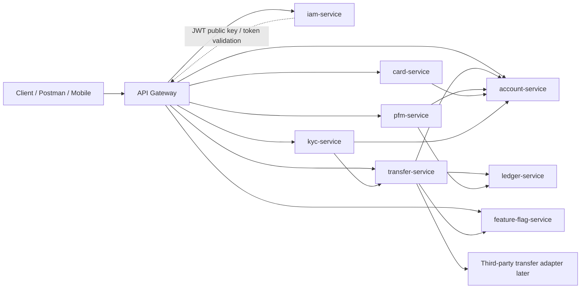
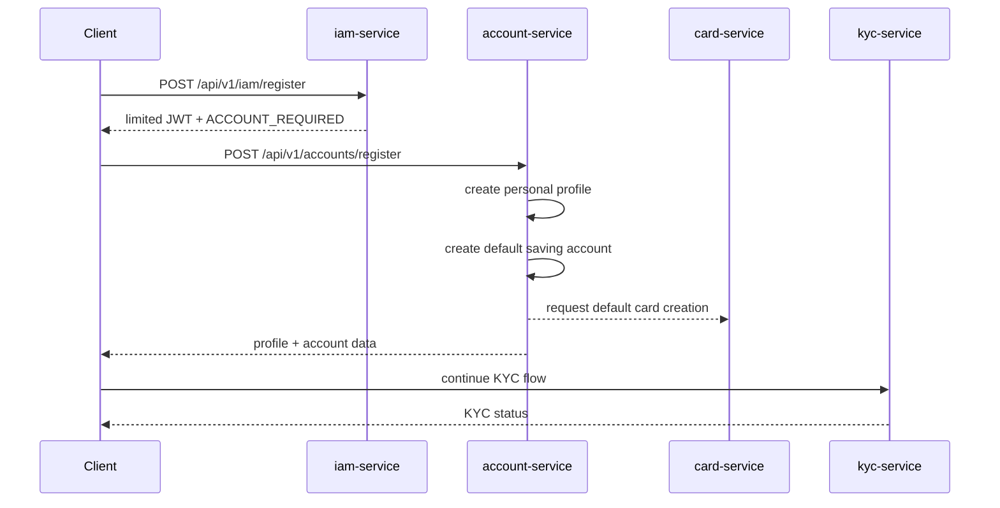
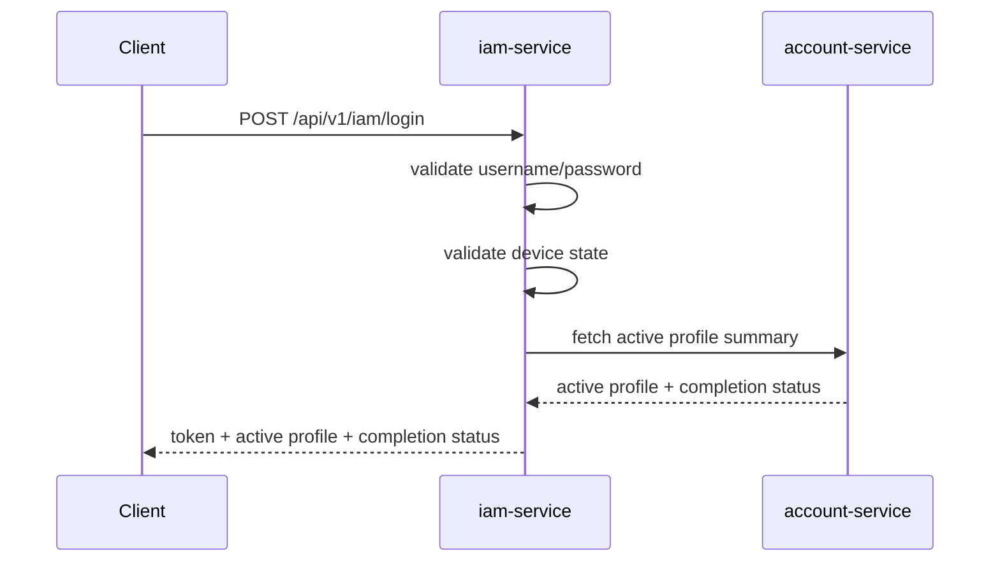
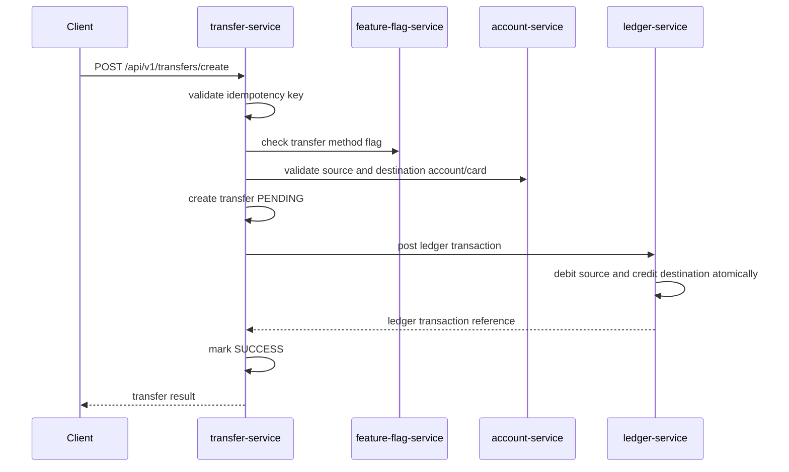

# Architecture Overview

## Project Goal

This project is a real production digital banking backend.

The system starts as independent Spring Boot microservices. Each service owns its own database, exposes APIs through HTTP, and publishes important business events. Implementation must preserve production-grade security, financial consistency, reliability, and observability from the beginning.

## Product Scope

The backend supports:

- User registration and login
- Device verification with 6-digit OTP
- JWT-based authentication
- User profiles, up to 5 profiles per user
- Default personal profile after registration
- Default saving account and default card creation
- Account listing, balance lookup, closing, destination owner lookup
- Card listing, ordering, freezing, blocking, expiration
- Public KYC job list and referral registration
- Referral reward after referred user completes KYC
- Feature flag listing and updates
- PFM transaction list and vault boxes
- Internal transfers now, external-compatible design for later
- Transfer history containing successful transfers only
- Auto-generated 10-digit account numbers and IBANs

## Core Services

```text
iam-service
account-service
card-service
kyc-service
feature-flag-service
pfm-service
transfer-service
ledger-service
api-gateway
```

`ledger-service` is added as a core internal service because this is a banking-style system. Transfers and referral rewards must affect real balances, but only through controlled ledger transactions. The ledger is the source of truth for financial movement.

## High-Level Architecture



## Important Architecture Rules

### 1. Every public business API uses context envelopes

Every public business API must use a top-level `context` object in both request and response.

Request `context` contains:

```text
request id
account
OS
app
device
network
```

Response `context` contains:

```text
request id
profile id
status
```

This contract is defined in [API Contract](./api-contract.md).

Important:

```text
client-provided account/profile/device/network context must be validated before use.
```

### 2. Each service owns its database

No service is allowed to directly read or write another service database.

Good:

```text
transfer-service calls account-service API
```

Bad:

```text
transfer-service reads account_db.accounts table
```

Reason: direct database sharing creates hidden coupling and makes the system hard to change.

### 3. Account balances are real, but owned by ledger

`account-service` owns account metadata:

```text
account type
account status
profile owner
account number
creation date
closing date
```

`ledger-service` owns money movement:

```text
ledger accounts
entries
balances
transaction references
```

Reason: financial balance must be changed by controlled debit and credit ledger entries, not by manually editing an account row. Account APIs can show balance, but that balance must come from `ledger-service` or from a cache synchronized from ledger events.

### 4. Transfer service orchestrates money movement

`transfer-service` receives transfer requests, validates method and source/destination, calls ledger to post financial entries, and stores transfer status.

It does not directly subtract and add balances in `account-service`. The real debit and credit happen inside `ledger-service`.

### 5. IAM owns identity only

`iam-service` owns:

```text
users
credentials
name and registered location
password hashes
devices
login sessions
OTP challenges
JWT signing keys
```

It does not own accounts, cards, KYC, balances, or transfers.

### 6. Use events for completed business facts

Events describe things that already happened:

```text
UserRegistered
DeviceVerified
ProfileCreated
AccountCreated
CardCreated
KycCompleted
ReferralRewardRequested
TransferSucceeded
TransferFailed
AccountClosed
```

Do not publish vague command-like events such as `DoTransfer`.

### 7. Start synchronous, prepare for async

In early implementation, services can communicate with REST.

For production quality, important state changes should use:

```text
transactional outbox
event consumer inbox
idempotency keys
retry handling
dead-letter queue later
```

This keeps service communication reliable without pretending distributed systems are simple.

## Registration Flow



Notes:

- Registration returns a limited token because the client needs to continue onboarding.
- Login later returns normal access only after the user is allowed to enter the app.
- The account completion status controls what the client should do next.

## Login Flow



## Account Completion Status

Suggested enum:

```text
REGISTERED
DEVICE_VERIFICATION_REQUIRED
ACCOUNT_REQUIRED
KYC_REQUIRED
KYC_PENDING
COMPLETED
SUSPENDED
```

The backend decides this state. The frontend only reacts to it.

## Transfer Flow



Important:

- Every create-transfer request must include an idempotency key.
- A retry must not create duplicate money movement.
- Successful transfer history is read from `transfer-service`, while financial truth is in `ledger-service`.

## Technology Direction

Recommended starting stack:

- Java 21
- Spring Boot
- API Gateway as the public entry point
- Maven Wrapper
- PostgreSQL per service
- Flyway for database migrations
- Docker Compose for local infrastructure
- Spring Web for REST APIs
- Spring Validation for request validation
- Spring Security for JWT validation
- Spring Actuator for health checks
- OpenAPI for Postman and API documentation

Later additions:

- Redis for OTP and gateway key-exchange temporary state if needed
- Kafka or RabbitMQ for events
- Observability stack: logs, metrics, tracing
- Secrets management
- CI pipeline

## Why PostgreSQL

Pros:

- Strong transaction support
- Excellent relational constraints
- Reliable indexing
- Good fit for accounts, transfers, audit, and ledger data
- Easy to run locally with Docker
- Works well with Spring Boot and Flyway

Cons:

- Requires schema design discipline
- Horizontal scaling needs planning
- Not as flexible as document databases for changing document-like shapes

For this project, PostgreSQL is the best default because the domain is financial and consistency matters.

## Why JWT

Pros:

- Services can validate tokens without calling IAM on every request
- Good fit for microservices
- Easy to pass identity, profile, device, and roles
- Works well with API Gateway

Cons:

- Revocation before expiration is harder than server-side sessions
- Token expiration forces the user to login again
- Sensitive claims must not be placed inside the token

Recommended:

```text
short-lived access token
no refresh token
expired token requires login again
asymmetric signing keys
key rotation support
```

## Production Concerns To Keep From Day One

- Validation on every API boundary
- Global error format
- Request correlation ID
- Idempotency for write operations
- Audit logs for sensitive actions
- No shared databases
- No plaintext passwords
- No custom homemade cryptography
- Database migrations in version control
- Tests around business rules
- Health checks for every service
- Separate local, test, and production configuration
