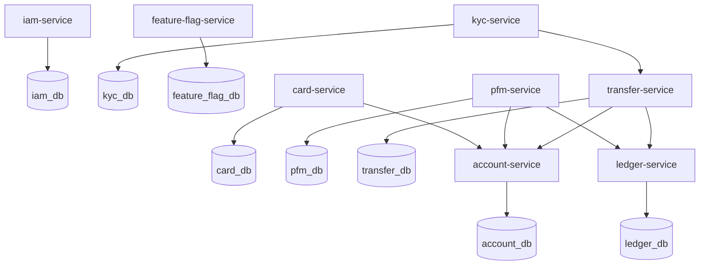

# Database Design

## Database Ownership



Diagram source: [databases.mmd](./diagrams/databases.mmd)

## Main Rule

Each microservice has its own PostgreSQL database.

```text
one service owns one database
other services communicate through APIs or events
```

This gives us clean boundaries and prevents hidden coupling.

## Shared Database Anti-Pattern

Do not do this:

```text
transfer-service -> account_db
pfm-service -> transfer_db
card-service -> account_db
```

This is easier at first, but it breaks microservice independence.

## Common Database Practices

Every database should have:

- UUID primary keys
- `created_at`
- `updated_at`
- Optimistic locking where useful
- Audit table or audit events for sensitive changes
- Flyway migrations
- Database constraints for important rules
- Indexes for lookup fields
- Outbox table when publishing events

Recommended ID style:

```text
UUID generated by application
```

Reason:

- Easier cross-service references
- No dependency on database sequence values
- Safer for distributed systems

## iam_db

Purpose:

```text
identity and authentication state
```

Suggested tables:

```text
users
credentials
devices
otp_challenges
login_sessions
jwt_signing_keys
outbox_events
```

### users

Important fields:

```text
id
username
phone_number
national_id
first_name
last_name
province
city
address
status
created_at
updated_at
```

Unique constraints:

```text
username
phone_number
national_id
```

Important:

```text
name and location are required during registration because they are part of the customer identity record.
```

If address history, postal code verification, or multiple addresses become required later, move address data into a dedicated `user_addresses` table instead of adding many address columns to `users`.

### credentials

Important fields:

```text
id
user_id
password_hash
password_algorithm
password_changed_at
created_at
updated_at
```

Password must never be stored as plaintext or reversible encrypted text.

### devices

Important fields:

```text
id
user_id
device_fingerprint
device_name
os
app_version
status
verified_at
created_at
updated_at
```

Device statuses:

```text
PENDING_VERIFICATION
VERIFIED
BLOCKED
REMOVED
```

### otp_challenges

Important fields:

```text
id
user_id
device_id
otp_hash
purpose
expires_at
attempt_count
status
created_at
updated_at
```

Never store raw OTP codes.

## account_db

Purpose:

```text
profiles and account metadata
```

Suggested tables:

```text
profiles
bank_accounts
account_status_history
profile_status_history
outbox_events
```

### profiles

Important fields:

```text
id
user_id
job_id
type
display_name
image_url
status
is_active
created_at
updated_at
```

Rules:

```text
first profile is PERSONAL
one user can have maximum 5 profiles
only one active profile at a time
job_id is selected from kyc-service jobs during registration
```

### bank_accounts

Important fields:

```text
id
profile_id
user_id
account_number
iban
type
status
currency
created_at
closed_at
updated_at
```

Rules:

```text
account_number is auto-generated and exactly 18 digits
iban is auto-generated using banking IBAN format rules
account_number and iban must be unique
```

Account types:

```text
VAULT
SAVING
CHEQUE
```

Account statuses:

```text
ACTIVE
CLOSED
INACTIVE
```

Important:

```text
no balance column as source of truth
```

Real balance changes are stored in `ledger_db`. If account data includes a balance for fast display, it must be clearly marked as cached and synchronized from ledger events.

## card_db

Purpose:

```text
card lifecycle and card status
```

Suggested tables:

```text
cards
card_orders
card_status_history
outbox_events
```

### cards

Important fields:

```text
id
user_id
profile_id
account_number
masked_pan
card_token
status
expires_at
created_at
updated_at
```

Card statuses:

```text
ACTIVE
INACTIVE
BLOCKED
FROZEN
EXPIRED
```

Security note:

```text
do not store raw card number unless PCI requirements are fully handled.
```

For this system, use `masked_pan` and an internal `card_token` unless full PCI DSS card-data handling is formally implemented.

## kyc_db

Purpose:

```text
KYC state, job list, referral registration
```

Suggested tables:

```text
jobs
kyc_cases
referrals
referral_rewards
outbox_events
```

### jobs

Important fields:

```text
id
title
code
is_active
created_at
updated_at
```

### kyc_cases

Important fields:

```text
id
user_id
status
completed_at
created_at
updated_at
```

KYC statuses:

```text
NOT_STARTED
IN_PROGRESS
PENDING_REVIEW
APPROVED
REJECTED
```

### referrals

Important fields:

```text
id
referred_user_id
referrer_user_id
referral_code
status
created_at
updated_at
```

Rules:

```text
referral can be set only during registration flow
referral cannot be changed later
reward is triggered after KYC is APPROVED
```

## feature_flag_db

Purpose:

```text
runtime feature control
```

Suggested tables:

```text
feature_flags
feature_flag_audit_logs
```

### feature_flags

Important fields:

```text
id
flag_key
enabled
description
updated_by
created_at
updated_at
```

Example keys:

```text
transfer.card-to-card.enabled
transfer.account-to-account.enabled
transfer.card-to-account.enabled
transfer.account-to-card.enabled
card.order.enabled
referral.reward.enabled
```

### feature_flag_audit_logs

Important fields:

```text
id
feature_flag_id
flag_key
old_enabled
new_enabled
old_description
new_description
changed_by
reason
request_id
created_at
```

Rules:

- Flag update and audit insert happen in one transaction.
- Audit rows are append-only.
- Store both old and new values, even when an operator submits the same value.
- Keep the request ID so operational changes can be traced across logs and services.

## pfm_db

Purpose:

```text
box metadata and PFM read experience
```

Suggested tables:

```text
boxes
box_presets
transaction_read_models
outbox_events
```

### boxes

Important fields:

```text
id
user_id
profile_id
account_number
title
preset_id nullable
image_url
status
created_at
updated_at
```

Important:

```text
account_number points to a VAULT account owned by account-service.
pfm-service stores display metadata only.
```

### box_presets

Important fields:

```text
id
title
image_url
sort_order
is_active
created_at
updated_at
```

## transfer_db

Purpose:

```text
transfer orchestration and transfer history
```

Suggested tables:

```text
transfers
transfer_parties
transfer_methods
idempotency_keys
transfer_status_history
outbox_events
```

### transfers

Important fields:

```text
id
request_id
user_id
profile_id
source_type
source_id
destination_type
destination_id
destination_display_name
destination_account_or_card_number
amount
currency
method
status
ledger_transaction_id nullable
failure_reason nullable
created_at
updated_at
```

Important:

```text
destination_display_name and destination_account_or_card_number are stored as a transfer history snapshot for recent-list display
do not store sensitive destination data in transfer history snapshots
```

Transfer statuses:

```text
PENDING
PROCESSING
SUCCESS
FAILED
CANCELLED
REVERSED
```

### idempotency_keys

Important fields:

```text
id
user_id
idempotency_key
request_hash
response_snapshot
status
expires_at
created_at
updated_at
```

Rule:

```text
same idempotency key and same request returns same result
same idempotency key and different request returns error
```

This prevents duplicate transfers when the client retries.

## ledger_db

Purpose:

```text
financial source of truth
```

Suggested tables:

```text
ledger_accounts
ledger_transactions
ledger_entries
ledger_balances
outbox_events
```

### ledger_accounts

Important fields:

```text
id
external_account_number
owner_user_id
currency
status
created_at
updated_at
```

`external_account_number` is the 18-digit account number from `account-service`.

### ledger_transactions

Important fields:

```text
id
reference_type
reference_id
transaction_type
status
created_at
updated_at
```

Reference examples:

```text
TRANSFER
REFERRAL_REWARD
CARD_PAYMENT
```

### ledger_entries

Important fields:

```text
id
ledger_transaction_id
ledger_account_id
direction
amount
currency
created_at
```

Directions:

```text
DEBIT
CREDIT
```

Important ledger rule:

```text
sum(debits) must equal sum(credits) for every ledger transaction.
```

### ledger_balances

Important fields:

```text
ledger_account_id
available_balance
current_balance
currency
updated_at
version
```

This table can be maintained transactionally for fast reads, but ledger entries remain the audit source.

## Outbox Table Pattern

Each service that publishes events should have:

```text
outbox_events
```

Suggested fields:

```text
id
aggregate_type
aggregate_id
event_type
payload
status
created_at
published_at
retry_count
```

Why:

```text
database change and event creation happen in the same transaction
publisher sends the event later
no lost events when service crashes
```

## Inbox Table Pattern

Services that consume events should have:

```text
inbox_events
```

Suggested fields:

```text
id
event_id
event_type
consumer_name
processed_at
status
```

Why:

```text
event consumers become idempotent
duplicate messages do not duplicate business actions
```
