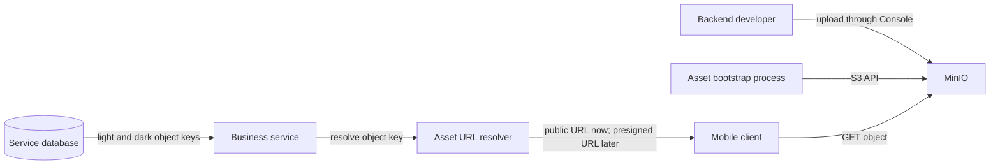

# Image and Asset Storage

## Scope

This document defines how `red-bank` stores and serves backend-managed visual
assets.

Initial asset owners:

```text
profiles
PFM box presets
PFM boxes through their selected preset
```

Bank accounts do not own images:

- A normal account can be displayed with its owning profile image.
- A `VAULT` account is associated with a PFM box.
- The box uses the image of its selected box preset.
- `bank_accounts` must not duplicate profile or box-preset image fields.

Users do not upload binary assets in the initial implementation. Backend
developers prepare and upload approved assets.

## Selected Storage

Use MinIO as the initial object-storage server.

MinIO provides:

- An S3-compatible HTTP API.
- Buckets and objects.
- A browser-based Console for developer uploads.
- Access policies.
- Public object access for the initial implementation.
- Presigned object URLs for the later private-access implementation.

MinIO is infrastructure, not a business microservice. Do not create a dedicated
image service for the initial implementation.

The application should use the standard S3 protocol and an S3-compatible Java
client rather than depending on MinIO-specific application APIs. This keeps a
future migration to AIStor or another S3-compatible provider limited mainly to
infrastructure and configuration.

The MinIO image and client dependencies must use pinned versions. Before a
production deployment, review the selected MinIO release's maintenance,
licensing, security-update, and support status.

## Architecture



Initial request flow:

```text
1. A service reads stable light and dark object keys from its database.
2. The service passes the keys to a shared URL-resolution component.
3. The resolver returns public MinIO URLs.
4. The API returns the URLs through Image(lightUrl, darkUrl, alt).
5. The mobile client downloads the object directly from MinIO.
```

Future private request flow:

```text
1. The database still returns the same stable object keys.
2. The resolver creates 15-minute presigned GET URLs.
3. The API returns the temporary URLs through the unchanged Image contract.
4. The client refreshes expired URLs through a normal business API response or
   a later asset-resolution endpoint.
```

## Key Components

### MinIO Server

The MinIO server stores object bytes on persistent storage and exposes the S3
API. The container is replaceable; its data volume is not.

### MinIO Console

The Console is the initial GUI for backend developers to:

- Create or inspect buckets.
- Upload approved assets.
- Inspect object metadata.
- Verify light and dark variants.

The Console must not be publicly accessible in production.

### Bucket

A bucket is the top-level environment storage boundary.

Suggested names:

```text
redbank-assets-develop
redbank-assets-prod
```

Bucket names are configuration. Do not store them in business tables.

### Object

An object contains:

```text
bucket
object key
binary content
content type
cache metadata
```

Supported visual formats:

| Format | Content type | Usage |
| --- | --- | --- |
| PNG | `image/png` | Raster images and icons. |
| SVG | `image/svg+xml` | Trusted developer-provided vector assets. |
| PDF | `application/pdf` | iOS vector image assets. |

PDF is treated as a visual asset in this project because the iOS client consumes
PDF files as image resources. Each format can have separate light and dark
objects.

### Object Key

An object key is the stable storage identity saved in PostgreSQL.

Examples:

```text
profiles/default-avatar/v1/light.pdf
profiles/default-avatar/v1/dark.pdf
pfm/box-presets/emergency/v1/light.svg
pfm/box-presets/emergency/v1/dark.svg
```

Rules:

- Do not include an environment name in the key.
- Do not store a MinIO endpoint in the key.
- Do not store query parameters or credentials.
- Use lowercase names and `/` as a logical grouping separator.
- Use explicit versions such as `v1` and `v2`.
- Upload a new version under a new key instead of replacing a cached object.

### S3 Client

The S3 client is used for infrastructure tasks and later URL signing. Initial
business-service reads do not require storage credentials when the bucket is
public.

### URL Resolver

Business code must not concatenate storage URLs throughout controllers and
services. A small shared implementation pattern resolves:

```text
bucket + object key -> client URL
```

The initial implementation creates a public URL. The later implementation uses
the same interface to create a 15-minute presigned URL.

The resolver is a small component or library pattern inside the services that
return images. It is not initially a separate network service.

## Data Model

Store stable object keys, not complete URLs:

```text
image_light_key
image_dark_key
image_alt
```

Do not store:

```text
http://localhost:9000/redbank-assets-develop/...
https://assets.example.com/...?X-Amz-Signature=...
```

Complete URLs couple data to an environment. Presigned URLs expire and therefore
must never be persisted as entity state.

### Profiles

Profiles own an image pair:

```text
image_light_key
image_dark_key
image_alt
```

New profiles receive backend-configured default values:

```text
profiles/default-avatar/v1/light.<format>
profiles/default-avatar/v1/dark.<format>
```

The exact default key is configuration or controlled seed data. It must not be
hardcoded repeatedly in application use cases.

The existing public `Image` request fields remain API-compatible for now.
Binary upload is not supported. When preset selection is implemented, the
backend must accept only approved backend-owned image references rather than
arbitrary external URLs.

### PFM Box Presets

Each box preset owns:

```text
image_light_key
image_dark_key
image_alt
```

Both light and dark keys are required for an active preset.

### PFM Boxes and Vault Accounts

A box references a box preset through `preset_id`.

Image resolution:

```text
box -> box preset -> light/dark object keys -> Image URLs
```

The box and its related `VAULT` bank account must not duplicate preset image
keys. A vault account display resolves its associated box and selected preset.

Changing a preset's image changes the display for boxes using that preset. New
asset content should use a new versioned object key so clients do not retain
stale cached bytes.

### Bank Accounts

`bank_accounts` has no image fields.

Display behavior:

```text
normal account -> owning profile image when the client needs an image
VAULT account -> associated box preset image
```

There are no saving, cheque, or vault account-type images.

## API Contract

Keep the current public contract:

```java
Image(
    String lightUrl,
    String darkUrl,
    String alt
)
```

The contract returns URLs because clients need downloadable locations. Service
databases store keys because keys are stable.

Every returned image should contain:

- A light URL.
- A dark URL.
- Short alternative text when meaningful.

The URL file extension and content type determine whether the object is PNG,
SVG, or PDF. `Image` does not need a format-specific field for the initial
implementation.

## Environment Management

Environments must not share writable storage.

### Local and Develop

- Run MinIO with Docker Compose.
- Store data in a named persistent volume.
- Use develop-only credentials.
- Use `redbank-assets-develop`.
- Allow public object reads.
- Allow uploads only through developer credentials.
- Expose the Console only to the developer or controlled develop network.

### Production

- Use a separate MinIO deployment and persistent storage.
- Use a separate `redbank-assets-prod` bucket.
- Use production-only credentials.
- Serve objects through HTTPS.
- Do not expose the Console publicly.
- Back up object data and required configuration.
- Monitor availability, disk usage, failed requests, and certificate expiry.
- Reassess high availability, supported MinIO/AIStor versions, and licensing
  before launch.

Production isolation must be physical or account/deployment based, not only an
object-key prefix.

## Configuration

Suggested environment variables:

```text
REDBANK_ASSET_ENDPOINT
REDBANK_ASSET_PUBLIC_BASE_URL
REDBANK_ASSET_BUCKET
REDBANK_ASSET_ACCESS_KEY
REDBANK_ASSET_SECRET_KEY
REDBANK_ASSET_REGION
REDBANK_ASSET_PATH_STYLE_ACCESS
REDBANK_ASSET_URL_MODE
REDBANK_ASSET_URL_TTL_SECONDS
```

Suggested values:

```text
develop:
  REDBANK_ASSET_URL_MODE=PUBLIC
  REDBANK_ASSET_URL_TTL_SECONDS=900

future private mode:
  REDBANK_ASSET_URL_MODE=PRESIGNED
  REDBANK_ASSET_URL_TTL_SECONDS=900
```

Credentials must come from environment variables or a secrets manager. They
must not be stored in application YAML, source code, database rows, mobile
applications, or API responses.

## Upload and Bootstrap

Initial upload workflow:

```text
backend developer -> MinIO Console -> approved bucket and object key
```

No public or user-facing upload API is implemented in this phase.

Canonical required assets should also be tracked in a controlled repository
location with a manifest containing:

```text
object key
source file
content type
cache policy
optional checksum
```

An idempotent bootstrap process should:

1. Wait for MinIO health.
2. Create the environment bucket when absent.
3. Apply the initial public-read policy.
4. Upload missing required default assets.
5. Apply content types and cache metadata.
6. Fail clearly when a required light or dark asset is missing.

The Console remains useful for inspection and controlled additions, while the
bootstrap process makes a fresh environment reproducible.

## Public Access Now

Initial bucket policy:

```text
anonymous clients can read objects
anonymous clients cannot list, upload, replace, or delete objects
```

Developer credentials can manage approved assets.

Use long-lived cache headers only with immutable versioned object keys:

```text
Cache-Control: public, max-age=31536000, immutable
```

Do not place credentials or sensitive data in visual assets. Public mode is
appropriate only for non-sensitive application artwork and display images.

## Private Access Later

The future security target applies 15-minute expiration to all returned assets:

```text
REDBANK_ASSET_URL_MODE=PRESIGNED
REDBANK_ASSET_URL_TTL_SECONDS=900
```

Migration steps:

1. Change the bucket from public-read to private.
2. Give the URL-signing backend identity read-only access.
3. Resolve every returned object key to a 15-minute presigned GET URL.
4. Keep database object keys unchanged.
5. Ensure clients can refresh expired URLs.
6. Avoid using a complete signed URL as the permanent cache identity.

Clients may cache bytes by stable object identity. A later API contract can
expose explicit object identifiers if client refresh behavior requires them.

## Security

Initial controls:

- Only trusted backend developers upload assets.
- Restrict upload formats to PNG, SVG, and PDF.
- Validate file extension, declared content type, and actual file signature.
- Apply practical file-size limits.
- Do not allow anonymous bucket listing.
- Do not expose MinIO administrator credentials to services or clients.
- Do not log storage secrets or presigned URL query parameters.
- Use TLS outside local development.
- Audit administrative asset changes in production.

SVG and PDF are accepted because uploads are developer-controlled. Before user
uploads are introduced, add content sanitization, malware scanning, quarantine,
ownership checks, rate limits, and stricter format policies.

## Future User Uploads

User avatars, identity documents, and videos are explicitly out of scope for the
initial implementation.

They require a separate design covering:

- Private buckets or prefixes.
- Per-user ownership and authorization.
- Upload size and content-type limits.
- Malware scanning and quarantine.
- Image processing and thumbnail generation.
- Video transcoding and streaming.
- Identity-document retention and deletion policy.
- Upload completion state and abandoned-object cleanup.
- Presigned upload URLs.
- Audit and privacy requirements.

Do not place future identity documents or private videos in the public display
asset bucket.

## Backup and Recovery

Required production controls:

- Back up object data outside the MinIO data disk.
- Back up bucket policy and required identity configuration.
- Keep the canonical default-asset manifest and sources in version control.
- Test restoration into a clean storage instance.
- Verify object counts, checksums, metadata, and required defaults.
- Document endpoint and credential rotation.

Database backup and object-storage backup must be coordinated because database
rows reference object keys.

## Migration to AIStor or Another S3 Provider

Use a side-by-side migration:

```text
1. Provision the new S3-compatible storage.
2. Create the target environment bucket.
3. Copy objects and metadata.
4. Verify object counts and checksums.
5. Apply equivalent access policies.
6. Change endpoint and credential configuration.
7. Run API and client verification.
8. Keep the old storage read-only during a rollback window.
```

Business database rows do not change because they store provider-independent
object keys.

## Testing

Minimum automated tests:

- Public URL resolution for light and dark keys.
- Presigned URL resolution with a 15-minute TTL.
- Missing object-key validation.
- Default profile image assignment.
- Active box presets require both light and dark keys.
- Box and vault display resolves through the selected preset.
- Bank accounts do not persist independent image fields.
- URLs are environment-specific while database keys remain unchanged.
- Storage credentials and signed query parameters are absent from logs.

Minimum integration checks:

- MinIO starts with persistent storage.
- Bootstrap creates the bucket and required assets.
- Anonymous clients can read but cannot list or write.
- PNG, SVG, and PDF content types are returned correctly.
- Restarting the MinIO container does not lose objects.
- A clean restore reproduces required default assets.

## Initial Acceptance Criteria

- MinIO runs through the develop Docker Compose environment.
- MinIO Console is available to backend developers.
- The develop bucket is created automatically.
- Required profile and box-preset light/dark assets are bootstrapped.
- PostgreSQL stores object keys instead of complete URLs.
- Profiles receive default image keys.
- Boxes and vault accounts resolve images through box presets.
- Bank accounts contain no image columns.
- Public URLs are returned through the current `Image` contract.
- PNG, SVG, and PDF assets work with their intended clients.
- No user upload API exists.
- The design can switch to private 15-minute presigned URLs without changing
  stored entity data.

