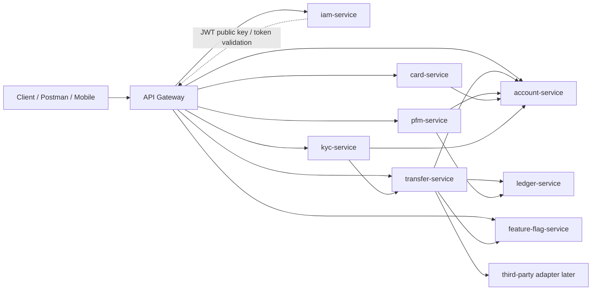

# Microservices Design

## Service Map



Diagram source: [microservices.mmd](./diagrams/microservices.mmd)

## Service Ownership

### iam-service

Purpose:

```text
identity, authentication, device trust, tokens
```

Owns:

- User identity
- Username, phone number, national ID uniqueness
- Name and registered location
- Password hash
- Device verification OTP
- Registered devices
- Access token lifecycle
- Account completion status calculation support

Main APIs:

```text
POST /api/v1/iam/register
POST /api/v1/iam/login
POST /api/v1/iam/device-verify
POST /api/v1/iam/logout
```

Does not own:

- Bank accounts
- Cards
- KYC data
- Ledger balances
- Transfer history

### account-service

Purpose:

```text
profiles and account metadata
```

Owns:

- Profiles
- Profile limit: maximum 5 profiles per user
- Default personal profile creation
- Account metadata
- Account number and IBAN generation
- Account balance lookup through ledger
- Account type: `VAULT`, `SAVING`, `CHEQUE`
- Account status: `ACTIVE`, `CLOSED`, `INACTIVE`
- Account closing lifecycle
- Destination owner lookup for transfers

Main APIs:

```text
POST /api/v1/account/register
POST /api/v1/account/close
POST /api/v1/account/open
POST /api/v1/account/list
POST /api/v1/account/balance/get
POST /api/v1/profile/create
POST /api/v1/profile/list
POST /api/v1/profile/edit
POST /api/v1/profile/active/set
POST /api/v1/account/owner/get
```

Important rule:

```text
account balances are real, but ledger-service is the source of truth.
```

`account-service` may return balance in account APIs, but the value must come from `ledger-service` or a read model synchronized from ledger events. Transfers must affect balances through ledger debit and credit entries.

### card-service

Purpose:

```text
card lifecycle
```

Owns:

- Card list
- Card ordering
- Default card creation after account registration
- Expire card
- Freeze/unfreeze by user
- Block by user/admin/system
- Unblock by admin/system
- Card status: `ACTIVE`, `INACTIVE`, `BLOCKED`, `FROZEN`, `EXPIRED`

Main APIs:

```text
POST /api/v1/cards/list
POST /api/v1/cards/order
POST /api/v1/card/freeze
POST /api/v1/card/unfreeze
POST /api/v1/card/block
POST /api/v1/card/unblock
POST /api/v1/card/expire
```

Current rule:

```text
card is linked to the default saving account.
```

Future rule:

```text
card-account relation can change later, so model it explicitly.
```

### kyc-service

Purpose:

```text
customer verification and referral registration
```

Owns:

- KYC state
- Public job list
- Referral code entered during registration flow
- Referral reward eligibility
- KYC completion events

Main APIs:

```text
POST /api/v1/kyc/jobs/list
POST /api/v1/kyc/referral/set
POST /api/v1/kyc/status/get
POST /api/v1/kyc/complete
```

Referral rule:

```text
referral can be set only during registration flow.
reward is paid after the referred user completes KYC.
```

### feature-flag-service

Purpose:

```text
runtime feature control
```

Owns:

- Flag list
- Flag updates
- Audit trail for flag changes
- Optional rollout rules later

Main APIs:

```text
POST /api/v1/feature-flags/list
POST /api/v1/feature-flags/update
```

Examples:

```text
transfer.card-to-card.enabled
transfer.account-to-account.enabled
card.order.enabled
referral.reward.enabled
```

### pfm-service

Purpose:

```text
personal finance management and box experience
```

Owns:

- Box metadata
- Box presets
- Box title and image
- PFM-specific read views

Main APIs:

```text
POST /api/v1/pfm/transactions/list
POST /api/v1/pfm/boxes/list
POST /api/v1/pfm/boxes/create
POST /api/v1/pfm/box-presets/list
POST /api/v1/pfm/boxes/edit
```

Important rule:

```text
box is a user-facing PFM concept backed by an account of type VAULT.
```

So box creation usually means:

```text
pfm-service stores box metadata
account-service creates VAULT account
ledger-service creates ledger account for the vault
```

### transfer-service

Purpose:

```text
transfer orchestration and transfer history
```

Owns:

- Transfer request
- Transfer method list
- Transfer status
- Successful recent list
- Idempotency tracking
- Third-party adapter integration later

Main APIs:

```text
POST /api/v1/transfers/create
POST /api/v1/transfers/methods/list
POST /api/v1/transfers/recent/list
```

Transfer methods:

```text
CARD_TO_CARD
ACCOUNT_TO_ACCOUNT
CARD_TO_ACCOUNT
ACCOUNT_TO_CARD
```

Transfer statuses:

```text
PENDING
PROCESSING
SUCCESS
FAILED
CANCELLED
REVERSED
```

Important rule:

```text
only SUCCESS transfers appear in recent-list.
```

### ledger-service

Purpose:

```text
financial source of truth
```

Owns:

- Ledger account
- Ledger transaction
- Debit and credit entries
- Balance calculation
- Financial audit trail

Internal APIs:

```text
POST /internal/v1/ledger/account/create
POST /internal/v1/ledger/account/close
POST /internal/v1/ledger/account/reopen
POST /internal/v1/ledger/transactions/internal-transfer
POST /internal/v1/ledger/transactions/referral-reward
POST /internal/v1/ledger/account/balance/get
POST /internal/v1/ledger/account/entries/list
```

Important rule:

```text
every financial movement must create balanced debit and credit ledger entries.
```

## Communication Style

### Synchronous REST

Use REST when the caller needs an immediate answer:

```text
transfer-service -> account-service: validate account
transfer-service -> feature-flag-service: check method enabled
transfer-service -> ledger-service: post transfer
iam-service -> account-service: get active profile summary
```

### Events

Use events when something happened and other services may react:

```text
UserRegistered
DeviceVerified
ProfileCreated
AccountCreated
CardCreated
KycCompleted
ReferralRewardRequested
TransferSucceeded
TransferFailed
AccountClosed
```

Initial implementation can start with REST and local tables. Production-ready implementation should add outbox/inbox patterns before depending heavily on async messaging.

## API Gateway Role

The API Gateway should handle:

- Public routing
- App-level key exchange
- Request payload decryption before service forwarding
- Request correlation ID
- JWT validation at the edge
- Rate limiting later
- Basic request logging
- Routing to internal service URLs

The services should still validate authorization internally. The gateway is useful, but it is not the only security layer.

Important:

```text
microservices receive raw decrypted request values and must not implement request encryption/decryption logic.
```

## Service Directory Plan

```text
red-bank
  contract
  api-gateway
  iam-service
  account-service
  card-service
  kyc-service
  feature-flag-service
  pfm-service
  transfer-service
  ledger-service
  docker-compose.yml
  docs
```

Each service should have the same internal structure:

```text
src/main/java/.../
  api
  application
  domain
  infrastructure
  config
  common
```

Meaning:

- `api`: controllers, request DTOs, response DTOs
- `application`: use cases and orchestration
- `domain`: business rules and domain models
- `infrastructure`: database, external HTTP clients, messaging
- `config`: Spring configuration
- `common`: shared local helpers inside that service only

Use one narrow shared contract module:

```text
contract
```

Allowed there:

- API envelope models
- `StatusCode`
- Shared enums
- Stable value models such as `Image`, `Location`, `Money`
- Shared display models such as account/card/profile summaries

Not allowed there:

- JPA entities
- repositories
- service classes
- domain use cases
- database migration models

Service-specific DTOs stay inside the owning service. This gives reuse for API contracts without coupling service internals.
