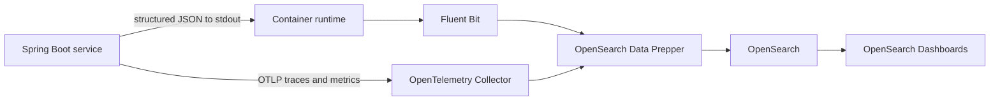

# Observability and Centralized Logging

## Scope

This document defines the telemetry contract for every backend service:

- Structured application logs.
- Metrics.
- Distributed traces.
- Correlation and request identifiers.
- Sensitive-data controls.
- Dashboards and alerts.
- Separation of operational telemetry from business audit records.

The OpenSearch deployment, security, storage, and operating model are defined in
[OpenSearch Observability Platform](./opensearch-platform.md).

## Current State

The project currently has:

- Plain-text console logs.
- `X-Correlation-Id` filters duplicated in every service.
- Correlation IDs added to the log-level pattern.
- No centralized collector or retention policy.
- No metrics backend.
- No distributed tracing backend.
- No consistent outbound context propagation from `RestClient` calls.
- A reactive gateway that writes directly to MDC even though execution can
  switch threads.

## Telemetry Architecture



Application code must not connect directly to OpenSearch or OpenSearch
Dashboards. Collectors buffer, enrich, redact, and route telemetry outside the
business process.

## Logging Contract

Deployed environments use structured JSON written to standard output. The
project uses Spring Boot's ECS console format as the initial JSON schema. ECS is
used as a field convention; it does not create a runtime dependency on Elastic.

Required fields when available:

```text
@timestamp
log.level
log.logger
message
service.name
service.version
service.environment
service.node.name
event.dataset
correlation.id
request.id
trace.id
span.id
transaction.id
http.request.method
http.route
http.response.status_code
event.duration
error.type
error.code
user.id
profile.id
device.id
client.address
```

Logging rules:

- Emit one request-completion event containing route, status, and duration.
- Use controlled error codes instead of parsing exception messages.
- Use low-cardinality indexed fields.
- Log stack traces only for unexpected failures.
- Do not log request or response bodies for sensitive APIs.
- Do not write application log files inside containers.

## Sensitive Data

Never log:

```text
password
OTP
authorization header
access token
refresh token
private or service token
encryption key material
full phone number
national ID
full account number
full card number or CVV
raw KYC evidence
database password or connection secret
```

Use internal UUIDs, controlled reason codes, or approved masked identifiers when
support correlation requires a business reference.

Redaction must exist at two levels:

1. Application logging helpers prevent sensitive values from being emitted.
2. Data Prepper removes blocked fields before indexing.

CI tests must exercise known sensitive fields and fail when they appear in
captured logs.

## Spring Boot Configuration

Shared develop and production profiles use:

```yaml
logging:
  structured:
    format:
      console: ecs
    ecs:
      service:
        environment: ${SPRING_PROFILES_ACTIVE}
```

Spring Boot includes MDC key/value pairs in ECS output. Use structured SLF4J
key/value logging for operational identifiers.

Developer machines use human-readable logs by default. Set
`REDBANK_LOG_FORMAT=ecs` when testing ingestion locally.

Production profile defaults to ECS JSON. `REDBANK_LOG_FORMAT=text` is reserved
for local troubleshooting and must not be used for deployed production.

## Correlation and Tracing

W3C Trace Context is the cross-service tracing contract:

```text
traceparent
tracestate
baggage only for approved low-risk values
```

`X-Correlation-Id` remains a support identifier:

- The API Gateway validates or creates it.
- The same value is returned to the client.
- It is added to logs and error responses.
- It is propagated to downstream services.
- It does not replace trace and span IDs.

Implementation requirements:

- Add Micrometer Tracing with OpenTelemetry.
- Export traces and metrics through OTLP to OpenTelemetry Collector.
- Instrument inbound HTTP, outbound HTTP, database, scheduled jobs, and event
  publishing.
- Propagate trace context through every `RestClient` call and gateway route.
- Enable Reactor context propagation in the API Gateway.
- Add task decoration for async executors and scheduled jobs.
- Include request ID, trace ID, span ID, and correlation ID in unexpected error
  logs.

## Metrics

Every service exposes Spring Boot Actuator metrics to the collector.

Required service metrics:

- HTTP request count, status, and duration.
- JVM heap, non-heap, garbage collection, threads, and process CPU.
- Database connection pool usage and wait time.
- Outbound HTTP request count, status, and duration.
- Authentication success, rejection, lockout, and OTP throttling.
- Outbox backlog, retry count, oldest pending age, and dead-letter count.
- Transfer and ledger success/failure counters using controlled reason codes.

Do not use customer identifiers as metric labels.

## Logging Is Not Audit

Operational telemetry answers:

```text
why is the system slow, failing, or behaving unexpectedly?
```

Business audit answers:

```text
who changed sensitive state, what changed, when, and under which authority?
```

Transfers, ledger postings, feature-flag changes, KYC decisions, account status,
and card status require durable service-owned audit records or append-only audit
events. OpenSearch can receive a searchable projection, but it is not the source
of truth for financial or regulatory audit.

## Environment Separation

### Developer Machine

- Human-readable console logs by default.
- Optional ECS JSON.
- Optional single-node OpenSearch profile for ingestion testing.
- Disposable telemetry and short retention.

### Shared Develop

- Dedicated OpenSearch stack.
- Dedicated collector and Data Prepper pipeline.
- Develop-only credentials, certificates, indexes, snapshots, and dashboards.
- Suggested retention: 7 to 14 days.
- DEBUG enabled only for selected packages and limited time windows.
- Test data only.

### Production

- Separate production OpenSearch cluster.
- Separate collector and Data Prepper pipeline.
- INFO default with controlled temporary logger changes.
- Suggested searchable retention: 30 to 90 days according to policy and
  capacity.
- TLS for every network hop.
- Least-privilege OpenSearch and Dashboards roles.
- Snapshot repository and tested restore procedure.
- Alerts for telemetry loss, ingestion delay, rejected documents, disk pressure,
  and cluster health.

Production telemetry must never be copied into develop.

## Index Naming

Use data-type, service, and environment boundaries:

```text
logs-redbank.api-gateway-develop
logs-redbank.iam-service-develop
logs-redbank.account-service-develop
logs-redbank.api-gateway-prod
logs-redbank.iam-service-prod
logs-redbank.account-service-prod

otel-v1-apm-span-develop
otel-v1-apm-service-map-develop
otel-v1-apm-span-prod
otel-v1-apm-service-map-prod
```

Templates, aliases, and lifecycle policies must be created by infrastructure
automation rather than manually in OpenSearch Dashboards.

## Minimum Dashboards

- Request rate, error rate, and latency by service and route.
- JVM and database connection pool health.
- Downstream service latency and failure rate.
- Authentication failures, OTP throttling, and lockouts.
- Transfer and ledger failures by safe internal reason code.
- Outbox backlog, retries, oldest pending age, and dead-letter state.
- Collector delivery failures and ingestion delay.
- OpenSearch cluster health, node health, disk usage, heap, and shard count.

## Minimum Alerts

- Sustained HTTP 5xx increase.
- Route latency exceeds its service objective.
- Authentication failure anomaly.
- Transfer or ledger failure spike.
- Outbox backlog or oldest pending age exceeds threshold.
- Database connectivity or pool exhaustion.
- Collector cannot deliver or Data Prepper rejects documents.
- Production service emits DEBUG unexpectedly.
- OpenSearch cluster becomes yellow/red or reaches disk watermark.
- Snapshot or restore verification fails.

## Access Controls

- Developers can access shared develop telemetry.
- Production access is approved, time-bounded where practical, and audited.
- Customer support uses curated dashboards with masked identifiers.
- Service accounts receive only ingestion permissions for their environment.
- Dashboard users cannot modify cluster settings or index policies.
- Sensitive production searches are reviewed according to security policy.

## Supply and Recovery

- Pin collector, Data Prepper, OpenSearch, and Dashboards versions.
- Mirror approved images and packages into an internal registry.
- Keep deployment manifests and certificates in controlled infrastructure
  repositories.
- Back up OpenSearch indexes through snapshots, not filesystem copies.
- Test snapshot restore before production readiness is approved.
- Keep application telemetry output compatible with OpenTelemetry so the
  application remains independent of backend implementation.

## Implementation Reference

See [OpenSearch Observability Platform](./opensearch-platform.md) for:

- Component topology.
- Develop and production deployment shape.
- Security roles and certificates.
- Data Prepper and collector pipelines.
- Index templates and lifecycle policies.
- Snapshot, restore, capacity, upgrade, and operations guidance.

## Official References

- [Spring Boot structured logging](https://docs.spring.io/spring-boot/3.5/reference/features/logging.html#features.logging.structured)
- [Spring Boot observability](https://docs.spring.io/spring-boot/3.5/reference/actuator/observability.html)
- [OpenTelemetry](https://opentelemetry.io/docs/)
- [OpenSearch Observability](https://opensearch.org/platform/opensearch-observability/)
- [OpenSearch Data Prepper](https://docs.opensearch.org/latest/data-prepper/)
