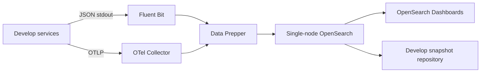
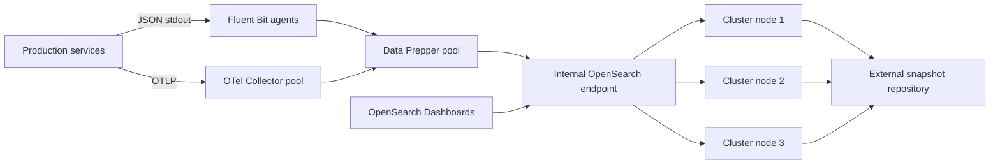

# OpenSearch Observability Platform

## Scope

This document defines how the project deploys and operates OpenSearch for
centralized logs, metrics, traces, dashboards, and alerts.

Application telemetry requirements are defined in
[Observability and Centralized Logging](./observability.md).

## Components

| Component | Responsibility |
| --- | --- |
| Fluent Bit | Reads container standard output and forwards structured logs. |
| OpenTelemetry Collector | Receives OTLP traces and metrics, batches telemetry, and exports it. |
| OpenSearch Data Prepper | Parses, validates, redacts, enriches, and routes telemetry. |
| OpenSearch | Stores and indexes telemetry. |
| OpenSearch Dashboards | Provides searches, dashboards, alerting, and operational views. |
| Snapshot repository | Stores recoverable cluster snapshots outside OpenSearch data nodes. |

Services do not receive OpenSearch credentials. Only collectors, Data Prepper,
Dashboards, infrastructure automation, and approved operators communicate with
the cluster.

## Topology

### Shared Develop



Develop characteristics:

- Single OpenSearch node is acceptable.
- One Data Prepper instance and one collector instance are sufficient.
- Security remains enabled.
- TLS may use an internal development CA.
- Retention is 7 to 14 days.
- Snapshots are optional for disposable local data and required for shared
  develop when dashboards or test evidence must survive.

### Production



Production characteristics:

- At least three cluster-manager-eligible nodes across independent failure
  domains.
- Dedicated data nodes when ingestion volume or retention requires them.
- At least two collector and Data Prepper instances.
- Internal load balancing and health checks.
- TLS on client, transport, Dashboards, and ingestion endpoints.
- External snapshot storage with tested restoration.
- No network route from develop workloads to the production cluster.

## Network Boundaries

Allowed flows:

```text
service runtime -> Fluent Bit
service runtime -> OpenTelemetry Collector
Fluent Bit -> Data Prepper
OpenTelemetry Collector -> Data Prepper
Data Prepper -> OpenSearch ingest endpoint
OpenSearch Dashboards -> OpenSearch
operator network -> OpenSearch Dashboards
OpenSearch -> snapshot repository
```

Blocked flows:

```text
application service -> OpenSearch
public internet -> OpenSearch REST API
public internet -> Data Prepper
develop network -> production OpenSearch
customer support network -> OpenSearch administrative API
```

## Security

### TLS

- Use an organization-controlled certificate authority.
- Use separate certificates for OpenSearch HTTP, node transport, Dashboards,
  Data Prepper, and collectors.
- Store private keys in the deployment secret manager.
- Define certificate rotation and expiry alerts.
- Do not disable certificate verification outside disposable local development.

### Identities

Create separate technical identities:

```text
data-prepper-develop
data-prepper-prod
dashboards-server-develop
dashboards-server-prod
snapshot-manager
index-bootstrap
cluster-monitor
```

Do not share credentials between environments or components.

### Roles

Minimum roles:

| Role | Permissions |
| --- | --- |
| `redbank_develop_reader` | Read develop telemetry and dashboards. |
| `redbank_prod_reader` | Read approved production telemetry. |
| `redbank_support_reader` | Read curated masked production views only. |
| `redbank_ingest_develop` | Create/write develop telemetry indexes only. |
| `redbank_ingest_prod` | Create/write production telemetry indexes only. |
| `redbank_observability_admin` | Manage templates, policies, dashboards, and alerts. |
| `redbank_cluster_operator` | Cluster, node, snapshot, and recovery operations. |

Ingestion identities cannot read historical production data. Dashboard readers
cannot change cluster settings, security configuration, or lifecycle policies.

## Log Ingestion

Spring Boot services write ECS JSON to standard output. Fluent Bit reads the
container log stream and sends it to Data Prepper.

Data Prepper performs:

1. JSON parsing.
2. Environment and service validation.
3. Timestamp normalization.
4. Removal of blocked fields.
5. Addition of ingestion metadata.
6. Routing to the correct environment/service index.
7. Dead-letter routing for rejected records.

Required ingestion metadata:

```text
observer.type
observer.version
event.ingested
service.environment
service.name
event.dataset
```

Events without a valid environment or service name are rejected rather than
routed to a shared fallback index.

### Local Develop Compose Profile

The repository includes an optional `observability` profile in
`docker-compose.develop.yml`:

```bash
docker compose --env-file .env.develop -f docker-compose.develop.yml --profile observability up -d
```

The profile starts:

| Service | Local URL | Purpose |
| --- | --- | --- |
| `opensearch` | `https://localhost:9200` | Single-node develop store. |
| `opensearch-dashboards` | `http://localhost:5601` | Search and dashboard UI. |
| `data-prepper` | `http://localhost:2021/health` | HTTP log ingestion and validation. |
| `data-prepper-init` | n/a | Renders the Data Prepper pipeline from env and prepares DLQ volume permissions. |
| `otel-collector` | `http://localhost:4318` | OTLP HTTP receiver for service traces and metrics. |
| `fluent-bit` | n/a | Docker container stdout collection. |
| `opensearch-bootstrap` | n/a | Applies templates, policies, and write aliases. |
| `opensearch-alerting-bootstrap` | n/a | Upserts develop OpenSearch Alerting monitors. |
| `opensearch-dashboards-bootstrap` | n/a | Imports develop Dashboards saved objects and indexes dashboard catalogs. |

Local develop credentials are intentionally disposable. The Dashboards username
is `admin`; the password comes from `REDBANK_OPENSEARCH_PASSWORD`.

Fluent Bit forwards only container log lines that already look like Redbank ECS
JSON. This keeps platform logs, database logs, and human-readable local service
logs out of the application log indexes. To ingest service logs through Fluent
Bit, run the service in a container with `REDBANK_LOG_FORMAT=ecs` and
`REDBANK_OBSERVABILITY_ENVIRONMENT=develop`.

### Local Ingestion Smoke Test

The Data Prepper pipeline can be tested directly, even before services are
containerized. Start the observability profile, then send one valid ECS log
wrapper:

```bash
curl -sS "http://localhost:2021/logs/ingest" \
  -H "Content-Type: application/json" \
  --data '[{"time":"2026-06-18T00:00:00.000000000Z","log":"{\"@timestamp\":\"2026-06-18T00:00:00.000Z\",\"log.level\":\"INFO\",\"message\":\"phase 13.2 smoke\",\"service.name\":\"api-gateway\",\"service.version\":\"0.1.0-SNAPSHOT\",\"service.environment\":\"develop\",\"event.dataset\":\"api-gateway\",\"correlation.id\":\"phase-13-2-smoke\",\"request.id\":\"phase-13-2-request\"}"}]'
```

Verify it is searchable:

The examples below assume `REDBANK_OPENSEARCH_PASSWORD` is exported in your
shell. The default in `.env.develop.example` is `RedbankDevelopAdmin123!`.

```bash
curl -sk -u "admin:${REDBANK_OPENSEARCH_PASSWORD}" \
  "https://localhost:9200/logs-redbank.api-gateway-develop/_search?q=correlation.id:phase-13-2-smoke"
```

Verify redaction by sending a blocked field:

```bash
curl -sS "http://localhost:2021/logs/ingest" \
  -H "Content-Type: application/json" \
  --data '[{"time":"2026-06-18T00:00:00.000000000Z","log":"{\"@timestamp\":\"2026-06-18T00:00:00.000Z\",\"log.level\":\"INFO\",\"message\":\"redaction smoke\",\"service.name\":\"api-gateway\",\"service.environment\":\"develop\",\"event.dataset\":\"api-gateway\",\"correlation.id\":\"phase-13-2-redaction\",\"password\":\"must-not-index\"}"}]'
```

The stored document must not contain `password` or `must-not-index`.

Verify dead-letter routing by omitting service metadata:

```bash
curl -sS "http://localhost:2021/logs/ingest" \
  -H "Content-Type: application/json" \
  --data '[{"time":"2026-06-18T00:00:00.000000000Z","log":"{\"@timestamp\":\"2026-06-18T00:00:00.000Z\",\"message\":\"missing service metadata\",\"correlation.id\":\"phase-13-2-deadletter\"}"}]'

curl -sk -u "admin:${REDBANK_OPENSEARCH_PASSWORD}" \
  "https://localhost:9200/deadletter-redbank.develop/_search?q=correlation.id:phase-13-2-deadletter"
```

## Trace and Metrics Ingestion

Services export OTLP to OpenTelemetry Collector. Collector processors should:

- Add deployment environment and service resource attributes.
- Batch exports.
- Limit memory usage.
- Retry transient delivery failures.
- Apply tail or probabilistic sampling only after baseline traffic is measured.
- Remove unapproved baggage and attributes.

Collector exports to Data Prepper OTLP endpoints. Data Prepper creates trace
indexes and service-map data in OpenSearch.

Local develop ports:

```text
service -> otel-collector:4318/v1/traces
service -> otel-collector:4318/v1/metrics
otel-collector -> data-prepper:21890
otel-collector -> data-prepper:21891
```

Trace analytics uses Data Prepper `otel_traces` and `service_map` processors.
Metrics use `otel_metrics` with flattened attributes and write through the
`metrics-redbank.develop` alias.

Metrics labels must remain low-cardinality. User IDs, profile IDs, transaction
IDs, account numbers, URLs with IDs, and exception messages are not metric
labels.

## Index Templates

Create version-controlled templates for:

```text
logs-redbank.*
otel-v1-apm-span-*
otel-v1-apm-service-map-*
metrics-redbank.*
deadletter-redbank.*
```

Templates define:

- Field mappings.
- Dynamic mapping limits.
- Shard and replica settings.
- Refresh interval.
- Index state management policy.
- Aliases.

Do not rely on unrestricted dynamic mappings. Unexpected nested payloads or
high-cardinality fields can exhaust cluster mappings and memory.

Develop templates are stored in:

```text
docker/observability/opensearch/index-templates
```

Application logs use per-service write aliases:

```text
logs-redbank.api-gateway-develop
logs-redbank.iam-service-develop
logs-redbank.account-service-develop
logs-redbank.ledger-service-develop
logs-redbank.card-service-develop
logs-redbank.kyc-service-develop
logs-redbank.feature-flag-service-develop
logs-redbank.transfer-service-develop
logs-redbank.pfm-service-develop
```

Invalid records use:

```text
deadletter-redbank.develop
```

## Lifecycle Policies

Initial retention targets:

| Data class | Develop | Production |
| --- | --- | --- |
| Application logs | 7 days | 30 days |
| Security operational events | 14 days | 90 days |
| Traces | 3 days | 7 to 14 days |
| Metrics | 14 days | 30 to 90 days |
| DEBUG logs | 1 day | Disabled or temporary |
| Dead-letter records | 3 days | 7 days |

These are starting values. Capacity tests, legal policy, security policy, and
incident requirements determine final production retention.

Lifecycle policies should:

1. Rollover by size and age.
2. Reduce replicas only in approved lower-cost stages.
3. Move older indexes to lower-cost storage when available.
4. Delete automatically at the end of retention.
5. Alert when rollover or deletion fails.

Financial and regulatory audit records do not use these deletion policies as
their source of truth.

Develop lifecycle policies are stored in:

```text
docker/observability/opensearch/ism-policies
```

Current develop defaults:

| Alias pattern | Rollover | Retention |
| --- | --- | --- |
| `logs-redbank.*-develop` | 1 day or 1 GB | 7 days |
| `deadletter-redbank.develop` | 1 day or 256 MB | 3 days |

## Snapshots and Restore

- Store snapshots outside the OpenSearch cluster.
- Use a repository dedicated to each environment.
- Encrypt snapshot storage.
- Prevent develop identities from reading production snapshots.
- Run scheduled incremental snapshots.
- Monitor failed and incomplete snapshots.
- Perform a documented restore test before production launch and at least
  quarterly afterward.

The restore runbook must cover:

1. Provisioning a clean compatible cluster.
2. Restoring security and platform configuration.
3. Registering the snapshot repository.
4. Restoring selected indexes.
5. Validating document counts and dashboards.
6. Reconnecting ingestion after validation.

## Capacity Planning

Measure:

```text
events per second
average and peak document size
daily log GB
daily trace span count
metric active series count
retention days
indexing CPU
JVM heap
disk growth
search latency
shard count
```

Production sizing must include:

- Peak ingestion rather than only daily average.
- Replica storage.
- Snapshot traffic.
- Segment merge overhead.
- At least 20 percent disk headroom below configured watermarks.
- Failure of one node without losing write availability.

Avoid many small indexes. Prefer rollover indexes per environment and service
group unless access or retention requires a separate boundary.

## Cluster Monitoring

Monitor the observability platform itself:

- Cluster health.
- Node availability.
- JVM heap and garbage collection.
- CPU and load.
- Disk usage and watermarks.
- Shard count, unassigned shards, and relocation.
- Indexing rejection and search rejection.
- Data Prepper queue depth and rejected events.
- Collector export errors and retry queue.
- Snapshot age and status.
- Certificate expiry.

Platform health alerts must be delivered through a path that does not depend
only on the affected OpenSearch cluster.

## Dashboards and Alerts as Code

Store exported dashboard, visualization, monitor, and index-template definitions
in version control.

Develop assets are stored under:

```text
docker/observability/opensearch/dashboards
docker/observability/opensearch/alerting/monitors
docker/observability/opensearch/alerting/platform-probes
```

The local Compose profile imports `redbank-develop-dashboards.ndjson`, indexes
`redbank-develop-dashboard-catalog.json`, and upserts every monitor JSON file.
Run the verifier after bootstrapping to inject controlled failures and dry-run
the monitors:

```sh
docker compose --env-file .env.develop -f docker-compose.develop.yml --profile observability run --rm --entrypoint sh opensearch-bootstrap /observability/opensearch/scripts/verify-alerts-develop.sh
```

Promotion flow:

```text
local validation
shared develop import
review
production import through deployment automation
```

Manual production changes must be exported and reconciled back into version
control.

## Production OpenSearch Assets

Phase 13.5 production assets are split by responsibility:

```text
deploy/observability/opensearch/production
docker/observability/opensearch/production
docker/observability/opensearch/scripts/bootstrap-production.sh
docker/observability/opensearch/scripts/validate-production-assets.sh
docs/runbooks/opensearch-production-operations.md
```

The deploy directory contains the production topology, network/TLS contract,
internal image mirror manifest, and required production-like tests. The
OpenSearch production directory contains API assets for:

- Production ISM policies.
- Production index templates.
- OpenSearch Security roles.
- Snapshot repository template.

Validate static assets locally with:

```sh
sh docker/observability/opensearch/scripts/validate-production-assets.sh
```

Production bootstrap must run only from approved deployment automation or an
approved operator workstation inside the production network. It refuses
localhost, `http://`, and the develop Compose endpoint:

```sh
REDBANK_PRODUCTION_OPENSEARCH_BOOTSTRAP=confirm-prod-opensearch-bootstrap \
OPENSEARCH_URL=https://internal-prod-opensearch.example.com:9200 \
OPENSEARCH_USERNAME=... \
OPENSEARCH_PASSWORD=... \
REDBANK_SNAPSHOT_BUCKET=... \
REDBANK_SNAPSHOT_REGION=... \
REDBANK_SNAPSHOT_ENDPOINT=... \
sh docker/observability/opensearch/scripts/bootstrap-production.sh
```

Production readiness is not complete until the capacity, node-failure,
ingestion-backpressure, snapshot-restore, and upgrade-rehearsal tests in
`deploy/observability/opensearch/production/production-readiness-test-plan.yaml` have
passing evidence.

## Version and Artifact Management

- Pin exact OpenSearch, Dashboards, Data Prepper, collector, and Fluent Bit
  versions.
- Use compatible versions from the same tested release set.
- Mirror approved container images into an internal registry.
- Retain manifests and installation artifacts for disaster recovery.
- Scan images before promotion.
- Review release notes and breaking changes before upgrades.

The local develop defaults are:

```text
OPENSEARCH_VERSION=2.19.5
OPENSEARCH_DASHBOARDS_VERSION=2.19.5
DATA_PREPPER_VERSION=2.11.0
DATA_PREPPER_PLATFORM=linux/amd64
FLUENT_BIT_VERSION=3.2.10
```

## Upgrade Procedure

1. Read release notes and compatibility requirements.
2. Test upgrade against restored production-like snapshots.
3. Validate ingestion, mappings, Dashboards, alerts, and security roles.
4. Take a fresh production snapshot.
5. Upgrade one supported version step at a time.
6. Confirm cluster health before continuing.
7. Keep rollback based on snapshot restoration rather than version downgrade.

## Environment Configuration

Suggested variables for deployment automation:

```text
REDBANK_OTEL_EXPORTER_OTLP_ENDPOINT
REDBANK_OTEL_EXPORTER_OTLP_TRACES_ENDPOINT
REDBANK_OTEL_EXPORTER_OTLP_METRICS_ENDPOINT
REDBANK_TRACING_SAMPLING_PROBABILITY
REDBANK_OTEL_METRICS_EXPORT_STEP
REDBANK_OBSERVABILITY_ENVIRONMENT
REDBANK_OPENSEARCH_ENDPOINT
REDBANK_OPENSEARCH_USERNAME
REDBANK_OPENSEARCH_PASSWORD
REDBANK_OPENSEARCH_CA_CERT
REDBANK_DATA_PREPPER_ENDPOINT
REDBANK_LOG_RETENTION_DAYS
REDBANK_TRACE_RETENTION_DAYS
REDBANK_METRIC_RETENTION_DAYS
REDBANK_SNAPSHOT_REPOSITORY
```

Application services receive only OTLP and logging configuration. OpenSearch,
Data Prepper, and snapshot credentials belong to infrastructure components.

## Implementation Order

1. Start single-node OpenSearch and Dashboards in an optional develop Compose
   profile.
2. Add Data Prepper and Fluent Bit log ingestion.
3. Create index templates, mappings, and lifecycle policies.
4. Enable ECS JSON in one service and validate redaction.
5. Roll structured logs through every service.
6. Add OpenTelemetry Collector.
7. Add Micrometer/OpenTelemetry traces and metrics to one service.
8. Validate gateway and downstream trace propagation.
9. Roll tracing and metrics through every service.
10. Add dashboards, alerts, dead-letter handling, and platform monitoring.
11. Build the production cluster, TLS, roles, and snapshot repository.
12. Run load, failure, restore, and upgrade tests.
13. Promote version-controlled observability assets to production.

## Acceptance Criteria

- Develop and production use separate clusters, credentials, certificates,
  indexes, and snapshots.
- Every deployed service emits valid structured JSON.
- Every request can be searched by correlation ID and trace ID.
- Gateway-to-service traces retain one distributed trace.
- Sensitive-value tests pass.
- Data Prepper rejects or dead-letters invalid events.
- Lifecycle rollover and deletion execute successfully.
- Dashboards show request, JVM, database, outbox, transfer, ledger, and platform
  health.
- Alerts are tested by controlled failure injection.
- Production is not publicly reachable.
- A production-like snapshot is restored successfully.
- Images and packages required for recovery exist in the internal registry.

## Official References

- [OpenSearch Observability](https://opensearch.org/platform/opensearch-observability/)
- [OpenSearch Docker installation](https://docs.opensearch.org/latest/install-and-configure/install-opensearch/docker/)
- [OpenSearch Security](https://docs.opensearch.org/latest/security/)
- [OpenSearch Data Prepper](https://docs.opensearch.org/latest/data-prepper/)
- [OpenSearch Index State Management](https://docs.opensearch.org/latest/im-plugin/ism/index/)
- [OpenSearch Snapshots](https://docs.opensearch.org/latest/tuning-your-cluster/availability-and-recovery/snapshots/)
- [OpenTelemetry Collector](https://opentelemetry.io/docs/collector/)
